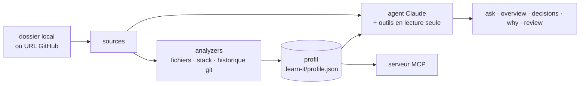

# learn-it

**Interroge n'importe quel projet. Comprends chaque décision technique. Améliore-les.**

learn-it analyse un projet (celui sur lequel tu travailles, ou n'importe quel dépôt GitHub) pour répondre à tes questions, reconstituer les décisions techniques qui l'ont façonné, puis dire lesquelles mériteraient d'être revues.

```bash
learn-it scan https://github.com/owner/repo     # la carte du projet, sans IA
learn-it ask "Comment fonctionne l'authentification ?"
learn-it decisions                              # les décisions techniques, au format ADR
learn-it review                                 # garder, améliorer ou remplacer, et par où commencer
```

> **Statut : v0.** `scan` fonctionne et est testé. Les commandes IA sont branchées et testées sans appel réel à l'API ; elles restent à éprouver sur de vrais projets. Voir la [roadmap](#roadmap).

## Le problème

Le code dit **quoi**. Presque jamais **pourquoi**.

Pourquoi PostgreSQL plutôt que MongoDB ? Pourquoi ce monorepo, pourquoi ce service à part ? La réponse est éparpillée dans l'historique git, les messages de commit, des docs à moitié à jour et la tête de gens partis depuis. Comprendre un projet en profondeur prend des semaines. Le modifier sans comprendre ses choix, c'est risquer de casser ce qui tenait pour une bonne raison.

learn-it rassemble ces indices et les fait parler.

## Ce que ça fait

| Commande | Question à laquelle elle répond | IA |
|---|---|:---:|
| `scan [CIBLE]` | De quoi est fait ce projet ? Langages, stack et date d'adoption de chaque techno, activité, fichiers les plus modifiés, docs, travail non commité. | non |
| `overview` | Comment est-il organisé ? Architecture (avec diagramme), flux principaux, carte du code, ordre de lecture. | oui |
| `ask "…"` | N'importe quelle question, avec une réponse sourcée. | oui |
| `decisions` | Quelles décisions techniques ont été prises, quand, pourquoi, avec quelles conséquences ? | oui |
| `why <cible>` | Pourquoi ce fichier, cette dépendance ou ce choix existe-t-il ? | oui |
| `review` | Ces décisions sont-elles toujours les bonnes ? Que changer, à quel coût, par où commencer ? | oui |
| `serve` | Les mêmes outils, pour ton agent (Claude Code, Cursor…) via MCP. | — |

La cible est un dossier local (par défaut le dossier courant) ou une URL GitHub : en argument pour `scan`, avec `-p/--project` pour les autres commandes. Un dépôt GitHub est cloné une fois, historique complet compris, dans `~/.cache/learn-it/`.

## Démarrage rapide

Il faut Python 3.11 ou plus, git, [uv](https://docs.astral.sh/uv/), et une clé API Anthropic pour les commandes IA.

```bash
git clone https://github.com/maximilien-ilic/learn-it && cd learn-it
uv tool install --editable .          # installe la commande learn-it ('.[mcp]' pour serve)
export ANTHROPIC_API_KEY=sk-ant-...   # ou : ant auth login

cd ~/code/mon-projet
learn-it scan                         # gratuit, quelques secondes
learn-it ask "Par où passe une commande, de l'API jusqu'à la base ?"
learn-it decisions
learn-it review
```

Les résultats sont enregistrés dans `.learn-it/` à la racine du projet analysé (`profile.json`, `overview.md`, `decisions.md` et `.json`, `review.md`). Ce dossier s'exclut lui-même de git.

### Depuis ton agent, via MCP

```bash
claude mcp add learn-it -- learn-it serve -p /chemin/vers/mon-projet
```

Ton agent dispose alors du profil du projet, des décisions reconstituées et des outils de recherche dans le code et l'historique.

## Comment ça marche



1. **Les faits d'abord.** `scan` construit un profil du projet sans IA. La stack vient des manifestes (`pyproject.toml`, `package.json`, `go.mod`, `Cargo.toml`, Dockerfile, compose, CI…), la date d'adoption de chaque techno vient de `git log -S`, et l'historique donne l'activité, les zones chaudes et le travail en cours.
2. **Puis l'enquête.** L'agent part de ce profil et explore le code comme le ferait un dev : il cherche (`git grep`), lit les passages utiles, remonte l'historique (`git log`, `git show`, `git blame`) jusqu'au commit qui a introduit un choix.
3. **Des réponses vérifiables.** Chaque affirmation cite sa source (`src/db.py:12-40`, `commit a1b2c3d`), et ce qui est documenté reste séparé de ce qui est déduit.

Principes :

- **Recherche agentique plutôt que RAG vectoriel.** Pas d'index à reconstruire : l'agent voit toujours l'état actuel du code, y compris le travail non commité d'un projet en cours ([ADR 0002](docs/adr/0002-recherche-agentique.md)).
- **Lecture seule.** Rien n'est exécuté ni modifié. L'agent ne lit pas les fichiers ignorés par git (`.env`…), les fichiers sensibles connus (`*.pem`, `id_rsa`…) ni le dossier `.git`.
- Les liens symboliques (fichiers et dossiers) sont exclus de l'analyse. Les sorties dans `.learn-it/` et les chemins du cache GitHub refusent également les liens symboliques.
- **Local d'abord.** L'analyse tourne sur ta machine ; seuls le profil et les extraits lus par l'agent partent vers l'API Claude.

## Structure du code

```
src/learn_it/
├── cli.py            commandes (Typer)
├── config.py         réglages lus dans l'environnement
├── domain.py         modèle de données : ProjectProfile, Technology, Decision…
├── sources.py        dossier local ou URL GitHub → projet sur disque
├── git.py            appels à git, sans shell
├── analyzers/        faits déterministes, sans IA
│   ├── inventory.py    fichiers, langages, docs
│   ├── stack.py        stack technique depuis les manifestes
│   └── history.py      activité, zones chaudes, dates d'adoption
├── agent/            la partie IA
│   ├── tools.py        outils en lecture seule (partagés avec MCP)
│   ├── prompts.py      consignes de chaque tâche
│   └── runner.py       boucle d'outils Claude
├── features.py       ask · overview · decisions · why · review
├── store.py          persistance dans .learn-it/
├── render.py         affichage terminal et rapports Markdown
└── mcp_server.py     learn-it serve
```

Les dépendances descendent : `analyzers` ignore tout de l'IA, `agent` ignore tout de la CLI. Pour ajouter une fonctionnalité : un prompt dans `agent/prompts.py`, une fonction dans `features.py`, une commande dans `cli.py`.

## Configuration

| Variable | Défaut | Rôle |
|---|---|---|
| `ANTHROPIC_API_KEY` | — | clé API (ou un profil `ant auth login`) |
| `LEARN_IT_MODEL` | `claude-opus-5-5` | modèle Claude |
| `LEARN_IT_EFFORT` | `high` | effort de raisonnement, de `low` à `max` ; vide pour les modèles qui ne le gèrent pas |
| `LEARN_IT_LANG` | `French` | langue des rapports (`ask` répond dans la langue de la question) |
| `LEARN_IT_MAX_ITERATIONS` | `40` | nombre maximal d'allers-retours de l'agent |
| `LEARN_IT_CACHE_DIR` | `~/.cache/learn-it` | où sont clonés les dépôts GitHub |

## Roadmap

- [x] CLI, projets locaux et dépôts GitHub
- [x] `scan` : langages, stack, dates d'adoption, activité, zones chaudes, docs, travail en cours
- [x] Agent Claude avec outils en lecture seule, et serveur MCP
- [x] `ask`, `overview`, `decisions`, `why`, `review` (v0, prompts à éprouver)
- [ ] Pull requests et issues GitHub liées aux commits : la meilleure source de *pourquoi*
- [ ] Analyse syntaxique (tree-sitter) : symboles et graphe de dépendances entre modules
- [ ] Export des décisions en ADR, un fichier par décision, dans le `docs/adr/` du projet
- [ ] Mode conversation (`chat`) qui garde le contexte d'une question à l'autre
- [ ] Suivi dans le temps : signaler les nouvelles décisions à chaque scan, en CI
- [ ] Jeu d'évaluation : des questions de référence sur des dépôts connus, pour mesurer la qualité des réponses

## Développement

```bash
uv sync --all-extras
uv run pytest
uv run ruff check .
```

Les décisions techniques de learn-it sont elles-mêmes documentées dans [`docs/adr/`](docs/adr/), au format ADR que l'outil vise à produire.
