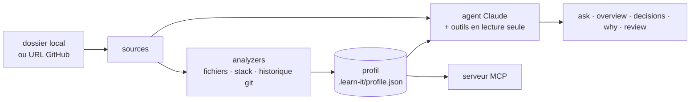

# learn-it

**Interroge n'importe quel projet. Comprends chaque décision technique. Améliore-les.**

learn-it analyse un projet (celui sur lequel tu travailles, ou n'importe quel dépôt GitHub) pour répondre à tes questions, reconstituer les décisions techniques qui l'ont façonné, puis dire lesquelles mériteraient d'être revues.

```bash
learn-it scan https://github.com/owner/repo     # la carte du projet, sans IA
learn-it ask "Comment fonctionne l'authentification ?"
learn-it decisions                              # les décisions techniques, au format ADR
learn-it review                                 # garder, améliorer ou remplacer, et par où commencer
```

> **Statut :** les neuf commandes fonctionnent et sont testées. La dernière mesure complète via Claude Code donne 12 cas réussis sur 14, dépôt Go compris ; la confirmation des dernières corrections reste partielle ([docs/evaluation.md](docs/evaluation.md)). Voir [Où en est le projet](#où-en-est-le-projet).

## Le problème

Le code dit **quoi**. Presque jamais **pourquoi**.

Pourquoi PostgreSQL plutôt que MongoDB ? Pourquoi ce monorepo, pourquoi ce service à part ? La réponse est éparpillée dans l'historique git, les messages de commit, des docs à moitié à jour et la tête de gens partis depuis. Comprendre un projet en profondeur prend des semaines. Le modifier sans comprendre ses choix, c'est risquer de casser ce qui tenait pour une bonne raison.

learn-it rassemble ces indices et les fait parler.

## Ce que ça fait

| Commande | Question à laquelle elle répond | IA |
|---|---|:---:|
| `scan [CIBLE]` | De quoi est fait ce projet ? Langages, stack et date d'adoption de chaque techno, activité, fichiers les plus modifiés, docs, travail non commité. | non |
| `overview` | Comment est-il organisé ? Architecture (avec diagramme), flux principaux, carte du code, ordre de lecture. | oui |
| `ask "…"` | N'importe quelle question, avec une réponse sourcée. | oui |
| `decisions` | Quelles décisions techniques ont été prises, quand, pourquoi, avec quelles conséquences ? | oui |
| `why <cible>` | Pourquoi ce fichier, cette dépendance ou ce choix existe-t-il ? | oui |
| `review` | Ces décisions sont-elles toujours les bonnes ? Que changer, à quel coût, par où commencer ? | oui |
| `chat` | Enchaîner les questions avec historique, streaming et sauvegarde. | oui |
| `diff [REF]` | Quelles technos et décisions ont changé depuis une révision Git ? | non |
| `serve` | Les mêmes outils, pour ton agent (Claude Code, Cursor…) via MCP. | — |

La cible est un dossier local (par défaut le dossier courant) ou une URL GitHub : en argument pour `scan`, avec `-p/--project` pour les autres commandes. Un dépôt GitHub est cloné une fois, historique complet compris, dans `~/.cache/learn-it/`.

## Démarrage rapide

Il faut Python 3.11 ou plus, git, [uv](https://docs.astral.sh/uv/), et, pour les commandes IA, soit une clé API Anthropic, soit [Claude Code](https://code.claude.com) connecté à un abonnement Claude.

```bash
git clone https://github.com/maximilien-ilic/learn-it && cd learn-it
uv tool install --editable .          # utilise '.[mcp]' pour serve ou le moteur claude-code
export ANTHROPIC_API_KEY=sk-ant-...   # ou : ant auth login
# ou, sans clé, avec ton abonnement Claude : export LEARN_IT_BACKEND=claude-code

cd ~/code/mon-projet
learn-it scan                         # gratuit, quelques secondes
learn-it ask "Par où passe une commande, de l'API jusqu'à la base ?"
learn-it decisions
learn-it review
```

Les résultats sont enregistrés dans `.learn-it/` à la racine du projet analysé (`profile.json`, `overview.md`, `decisions.md` et `.json`, `review.md`). Ce dossier s'exclut lui-même de git. Le profil est recalculé à chaque commande, donc il suit le travail non commité ; un scan prend moins d'une seconde sur des dépôts de plusieurs milliers de commits.

### Depuis ton agent, via MCP

```bash
claude mcp add learn-it -- learn-it serve -p /chemin/vers/mon-projet
```

Ton agent dispose alors du profil du projet, des décisions reconstituées et des outils de recherche dans le code et l'historique.

## Comment ça marche



1. **Les faits d'abord.** `scan` construit un profil du projet sans IA. La stack vient des manifestes (`pyproject.toml`, `package.json`, `go.mod`, `Cargo.toml`, Dockerfile, compose, CI…), la date d'adoption de chaque techno vient de `git log -S`, et l'historique donne l'activité, les zones chaudes et le travail en cours.
2. **Puis l'enquête.** L'agent part de ce profil et explore le code comme le ferait un dev : il cherche (`git grep`), lit les passages utiles, remonte l'historique (`git log`, `git show`, `git blame`) jusqu'au commit qui a introduit un choix.
3. **Des réponses vérifiables.** Chaque affirmation cite sa source (`src/db.py:12-40`, `commit a1b2c3d`), et ce qui est documenté reste séparé de ce qui est déduit.

Principes :

- **Recherche agentique plutôt que RAG vectoriel.** Pas d'index à reconstruire : l'agent voit toujours l'état actuel du code, y compris le travail non commité d'un projet en cours ([ADR 0002](docs/adr/0002-recherche-agentique.md)).
- **Outils d'enquête en lecture seule.** L'analyse lit le code et l'historique ; elle exclut les fichiers ignorés par git (`.env`…), les fichiers sensibles connus (`*.pem`, `id_rsa`…) et les internes Git. Les rapports vont dans `.learn-it/`. L'export ADR est explicite ; la publication de recommandations en tickets exige une confirmation.
- Les liens symboliques (fichiers et dossiers) sont exclus de l'analyse. Les sorties dans `.learn-it/` et les chemins du cache GitHub refusent également les liens symboliques.
- **Local d'abord.** L'analyse tourne sur ta machine ; seuls le profil et les extraits lus par l'agent partent vers l'API Claude.

## Structure du code

```
src/learn_it/
├── cli.py            commandes (Typer)
├── config.py         réglages lus dans l'environnement
├── domain.py         modèle de données : ProjectProfile, Technology, Decision…
├── sources.py        dossier local ou URL GitHub → projet sur disque
├── git.py            appels à git, sans shell
├── analyzers/        faits déterministes, sans IA
│   ├── inventory.py    fichiers, langages, docs
│   ├── stack.py        stack technique depuis les manifestes
│   └── history.py      activité, zones chaudes, dates d'adoption
├── agent/            la partie IA
│   ├── tools.py        outils en lecture seule (partagés avec MCP)
│   ├── prompts.py      consignes de chaque tâche
│   └── runner.py       boucle d'outils Claude
├── features.py       ask · overview · decisions · why · review
├── evidence.py       vérification des citations : fichier:ligne et commits
├── store.py          persistance dans .learn-it/
├── render.py         affichage terminal et rapports Markdown
└── mcp_server.py     learn-it serve

evals/                évaluation des réponses IA
├── cases.toml        projets de référence, questions et preuves attendues
├── shop.py           projet synthétique à l'historique figé (aussi utilisé par les tests)
├── scoring.py        barème : citations valides, faits, sources, déductions signalées
└── run.py            exécution avec la vraie API (jamais en CI)
```

Les dépendances descendent : `analyzers` ignore tout de l'IA, `agent` ignore tout de la CLI. Pour ajouter une fonctionnalité : un prompt dans `agent/prompts.py`, une fonction dans `features.py`, une commande dans `cli.py`.

## Configuration

| Variable | Défaut | Rôle |
|---|---|---|
| `ANTHROPIC_API_KEY` | — | clé API (ou un profil `ant auth login`) |
| `LEARN_IT_BACKEND` | `api` | `api` (crédits API) ou `claude-code` : passe par `claude -p` et l'abonnement Claude, sans streaming, sans `chat` ni `--repair-citations` |
| `LEARN_IT_MODEL` | `claude-opus-5-5` | modèle Claude |
| `LEARN_IT_EFFORT` | `high` | effort de raisonnement, de `low` à `max` ; vide pour les modèles qui ne le gèrent pas |
| `LEARN_IT_LANG` | `French` | langue des rapports (`ask` répond dans la langue de la question) |
| `LEARN_IT_MAX_ITERATIONS` | `40` | nombre maximal d'allers-retours de l'agent |
| `LEARN_IT_CACHE_DIR` | `~/.cache/learn-it` | où sont clonés les dépôts GitHub |

## Où en est le projet

*État au 17 novembre 2026.*

**Ce qui marche.** Les neuf commandes sont en place, couvertes par 305 tests qui tournent sous Python 3.11 et 3.14 à chaque PR.

- **Le scan.** Il reconnaît Python, JavaScript/TypeScript, Go, Rust, Java/Kotlin, Ruby, PHP, .NET et l'infrastructure (Docker, Kubernetes, Terraform, Helm). Il date chaque techno, y compris à travers une migration de manifeste (`setup.py` → `pyproject.toml`), met à part les technos des exemples et des tests, lit les ADR déjà écrits et construit le graphe des imports avec tree-sitter, en moins d'une seconde sur un dépôt de 8 000 commits et en 13 s sur golang/go (68 707 commits).
- **L'agent.** Il cite ses sources, vérifiées automatiquement, et peut corriger ses citations fausses (`--repair-citations`). Il lit aussi les PR GitHub liées aux commits, et chaque commande affiche son coût et sa durée.
- **Les décisions.** Elles s'exportent en ADR (`decisions --export`), avec refus si aucune preuve n'est vérifiable et avertissement pour chaque référence invalide. Les recommandations peuvent devenir des tickets (`review --issues`), et `diff` suit leur évolution.
- **Le moteur.** learn-it tourne avec une clé API, ou sur un abonnement Claude via Claude Code (`LEARN_IT_BACKEND=claude-code`).
- **La revue.** Une revue Codex relit chaque commit qui arrive sur `master`, et une revue Claude côté serveur est prête ([docs/claude-review.md](docs/claude-review.md)).
- **La licence.** Le code est sous licence MIT.

**Ce qui reste à prouver.** La dernière mesure complète donne 12/14, dépôt Go compris. La complétion locale des chemins abrégés fait passer les deux rapports ratés en rejeu hors ligne. La confirmation avec de nouvelles réponses reste partielle : 4/6, dont une revue Express sans le mot attendu « middleware » et une revue Go bloquée par le quota Claude. Il reste à confirmer ces corrections, mesurer la variabilité et comparer les efforts avec le prompt actuel, puis mesurer le moteur API.

**Ce qu'il reste à faire.**

| # | Étape | Ticket | En attente de |
|---|---|---|---|
| 1 | Confirmer les corrections, mesurer variabilité, effort et moteur API | [#10] | quota Claude ; une clé pour le moteur API |
| 2 | Corriger par l'IA les preuves structurées (complétion locale et garde à l'export faits) | [#34] | mesure du gain de la correction API (#10) |
| 3 | Versions et publication sur PyPI (licence MIT faite) | [#24] | la fin du projet |
| 4 | Activer la revue côté serveur | [#25] | le secret `CLAUDE_CODE_OAUTH_TOKEN` |

Les jalons, l'historique du projet et le détail de chaque étape sont dans [docs/roadmap.md](docs/roadmap.md).

[#10]: https://github.com/maximilien-ilic/learn-it/issues/10
[#24]: https://github.com/maximilien-ilic/learn-it/issues/24
[#25]: https://github.com/maximilien-ilic/learn-it/issues/25
[#34]: https://github.com/maximilien-ilic/learn-it/issues/34

## Développement

Les [commandes de suivi des décisions](docs/decision-workflow.md) décrivent la
vérification des citations, l'export ADR, les recommandations en JSON, les tickets
sur confirmation et `learn-it diff`. Voir aussi les
[sources GitHub et ADR](docs/project-sources.md), le
[graphe des imports](docs/code-structure.md) et le
[chat, streaming et bilan d'usage](docs/agent-experience.md).

```bash
uv sync --all-extras
uv run pytest
uv run ruff check .
```

La CI GitHub (`.github/workflows/ci.yml`) lance ces contrôles sous Python 3.11 et 3.14, sur chaque PR et chaque push sur `master`.

### Évaluation

`pytest` ne couvre que la partie déterministe. Pour mesurer les vraies réponses de Claude, avec une clé API ou avec l'abonnement via Claude Code (`--backend claude-code`) :

```bash
uv run python -m evals.run           # tous les projets de référence (consomme des tokens)
uv run python -m evals.run shop      # seulement ceux nommés
uv run --extra mcp python -m evals.run --backend claude-code   # sur l'abonnement Claude
```

Chaque cas de `evals/cases.toml` vérifie que les citations `fichier:ligne` et les commits cités existent, que les faits et les sources attendus sont présents, que ce que rien ne documente est signalé comme déduit, et qu'aucun secret ne fuit. Le texte exact n'est jamais comparé.

Les décisions techniques de learn-it sont elles-mêmes documentées dans [`docs/adr/`](docs/adr/), au format ADR que l'outil vise à produire.

## Licence

MIT, voir [LICENSE](LICENSE).
